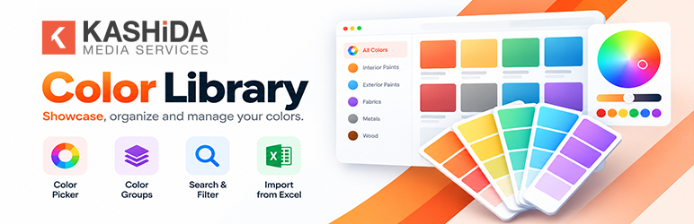
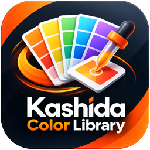
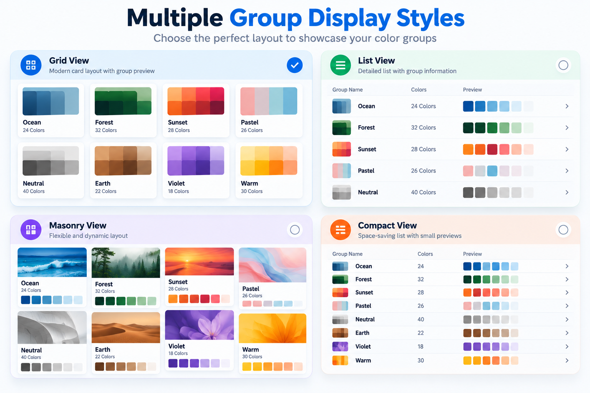
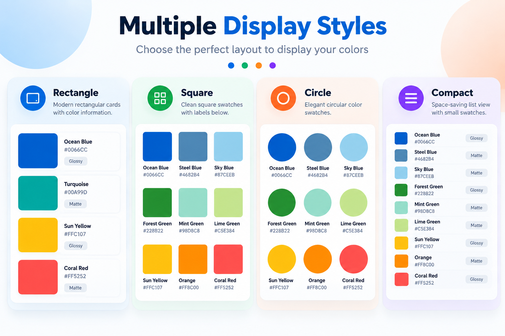
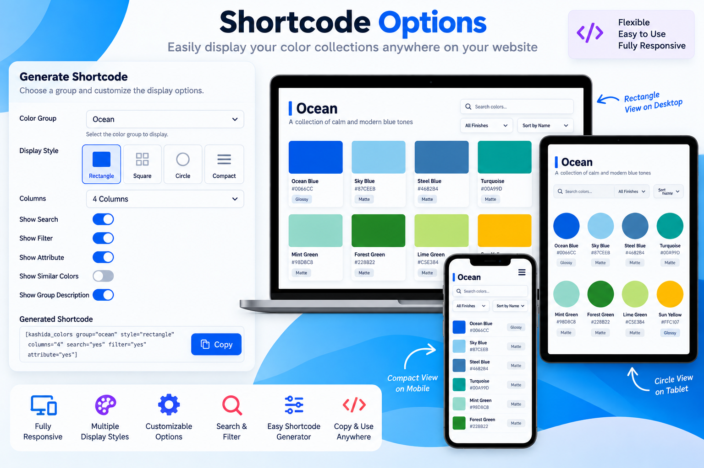
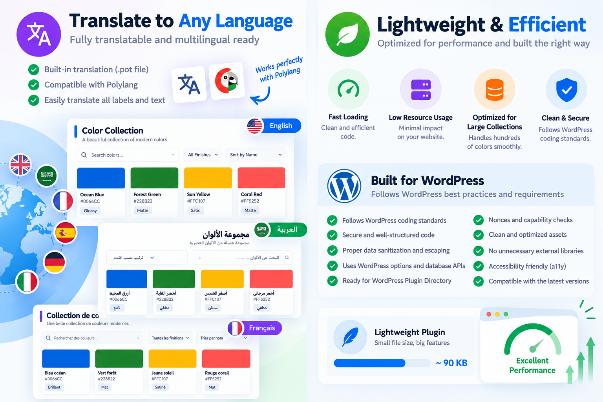
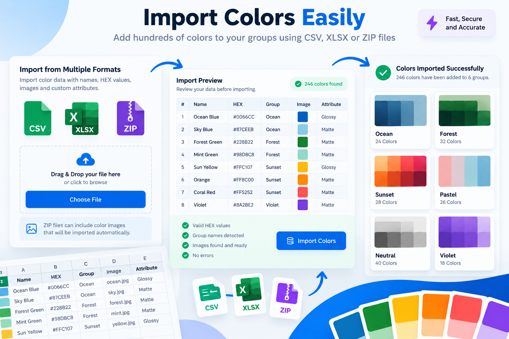
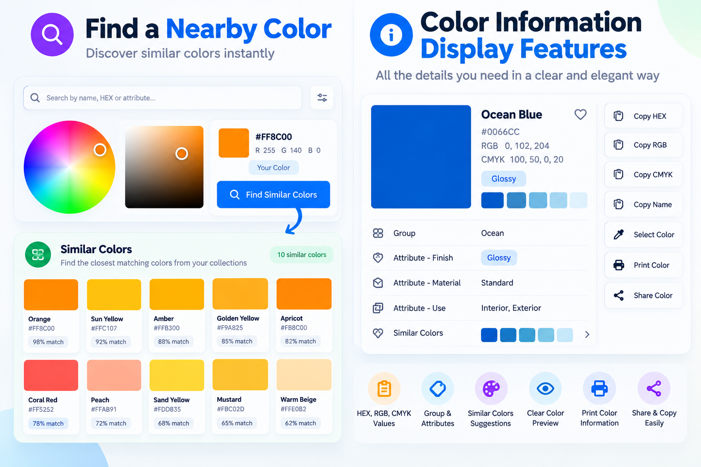
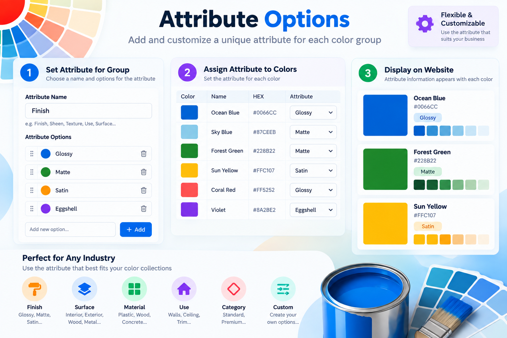

  
   
  

# Kashida Color Library

**Create and display professional color collections with custom attributes, images, responsive layouts, search, filters, similar colors, color tools, and CSV/XLSX/ZIP import.**

Kashida Color Library is a lightweight WordPress plugin for creating, managing, and displaying professional color collections on your website.

It provides an organized way to create color groups, add color information, upload sample images, define custom attributes, and present collections using responsive display layouts. It is suitable for paint brands, fabrics, interior materials, plastics, wood, ceramics, printing, automotive, cosmetics, product catalogs, and any business that needs a dedicated color guide.

 

[Download the latest release](https://github.com/mrwan-bg/kashida-color-library/releases) · [Report a bug](https://github.com/mrwan-bg/kashida-color-library/issues) · [Kashida Media Services](https://kashida.ly/)

> **Version:** 2.6.14 · **License:** GPL-2.0-or-later

## Features

### Multiple display styles
Choose from four responsive styles for color groups and colors:

- **Rectangle** — Modern rectangular cards for detailed color presentations.
- **Square** — Clean square layouts for visual color collections.
- **Circle** — Circular color swatches for compact presentations.
- **Compact** — Space-saving layouts for displaying many colors efficiently.

Display styles can be configured independently for collections and individual color groups.

### Color groups and collections
Create organized groups with a name, code, description, featured image, custom attribute, attribute options, and multiple colors. Display groups individually or combine them into a collection using shortcodes. Collection Listing provides an overview of multiple groups.

### Detailed color information
Display color name, color code, HEX, RGB, HSL, custom attributes, and sample images. Choose which information visitors can see.

### Custom attributes
Define group-specific attributes such as Finish, Surface, Material, Texture, Use, Category, or Collection. Set the available options to suit your industry.

### Search, filters, and sorting
Help visitors find colors using search, group filters, attribute filters, sorting, and responsive controls. Search can use available color information such as names and codes.

### Similar and nearby colors
The **Find a Nearby Color** tool helps visitors discover related colors from available collections. The Color Wheel provides an interactive way to explore colors and nearby shades.

### Copy, select, print, and share
Visitors can select colors, view their selections, copy enabled color details, print or share color information, and explore similar colors.

### CSV, XLSX, and ZIP import
Import color collections and associated sample images. Supported data can include color name, code, HEX, RGB, HSL, group, attribute, and image. The importer supports preview, validation, and duplicate handling.

### Responsive columns
Configure independent column counts for desktop, tablet, and mobile devices.

### Shortcode Generator
Select a color group or collection, choose the style, configure responsive columns and display options, then generate a shortcode without writing code.

### Lightweight and privacy-focused
Color groups and color information are stored within your WordPress website. The plugin does not require an external database, third-party API, or external analytics service. Imported images and color data remain on your website.

## Screenshots

### 1. Overview

### 2. Color groups

### 3. Color display

### 4. Color tools

### 5. Import and management

### 6. Display configuration

### 7. Additional interface

### 8. Additional interface

## Installation

1. Download the plugin ZIP from the [Releases page](https://github.com/mrwan-bg/kashida-color-library/releases).
2. In WordPress, open **Plugins → Add New Plugin → Upload Plugin**.
3. Upload the ZIP file and select **Install Now**.
4. Activate **Kashida Color Library** from **Plugins → Installed Plugins**.
5. Open **Color Groups** in the WordPress administration menu.
6. Create a color group and add colors manually or import CSV, XLSX, or ZIP data.
7. Configure the group, color information, and optional attributes.
8. Open the Shortcode Generator and configure the display.
9. Copy the generated shortcode into a page or post and publish it.

## Requirements

- WordPress 5.8 or later
- PHP 8.0 or later

The plugin does not require a Google Maps API, external database, or third-party service.

## Plugin information

The latest GitHub release is **v2.6.14**, which includes Help and Settings page layout improvements, full-width admin content, and refinements to Arabic RTL and English LTR presentation.

| Property | Value |
|---|---|
| Version | 2.6.14 |
| Requires WordPress | 5.8 or later |
| Tested up to | WordPress 7.1 |
| Requires PHP | 8.0 or later |
| License | GPL-2.0-or-later |
| Text domain in the supplied plugin source | `kashida-color-library` |
| Display styles | Rectangle, Square, Circle, Compact |
| Import formats | CSV, XLSX, ZIP |
| Color values | HEX, RGB, HSL, code, attributes, images |
| Responsive columns | Desktop, tablet, mobile |
| External services required | None |
| Tracking / telemetry | None |
| REST API required | No |

## Translation and multilingual support

The plugin is designed for WordPress gettext translations and `.po` / `.mo` files, and supports multilingual workflows including plugins such as Polylang.

## Privacy

Color groups and color information are stored locally within the WordPress website. The plugin does not send color data to Kashida servers and does not require external analytics.

## Latest release: 2.6.14

- Redesigned the Help page to match the Settings page.
- Expanded Help and Settings to use the available WordPress admin content width.
- Improved spacing, alignment, responsive behavior, and RTL/LTR presentation.
- Improved the layout of import templates, tables, and shortcode examples.

## Contributing

Bug reports and feature requests are welcome. Please use the repository's [Issues](https://github.com/mrwan-bg/kashida-color-library/issues) page and read [CONTRIBUTING.md](CONTRIBUTING.md) before submitting changes.

## Developer

**Kashida Media Services** — [https://kashida.ly/](https://kashida.ly/)  
**Developer:** Mrwan elGobee — [Behance](https://www.behance.net/Mrwan_elgobee)

## License

This project is distributed under the **GNU General Public License v2.0 or later**. See [LICENSE](LICENSE).
