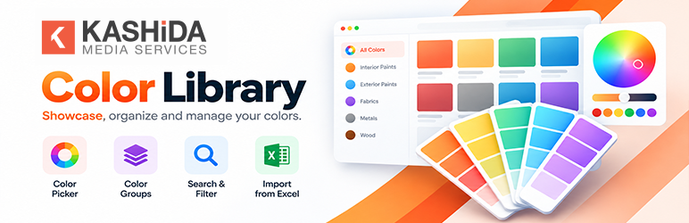
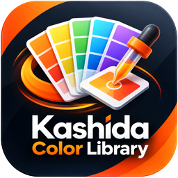
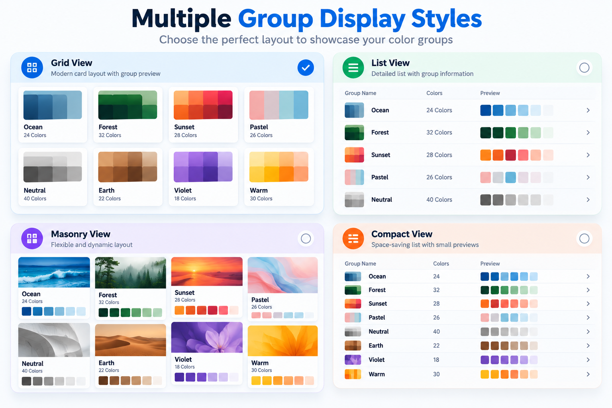
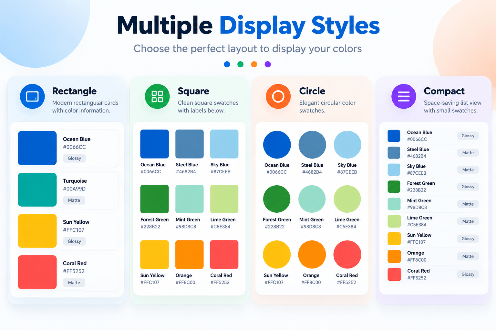
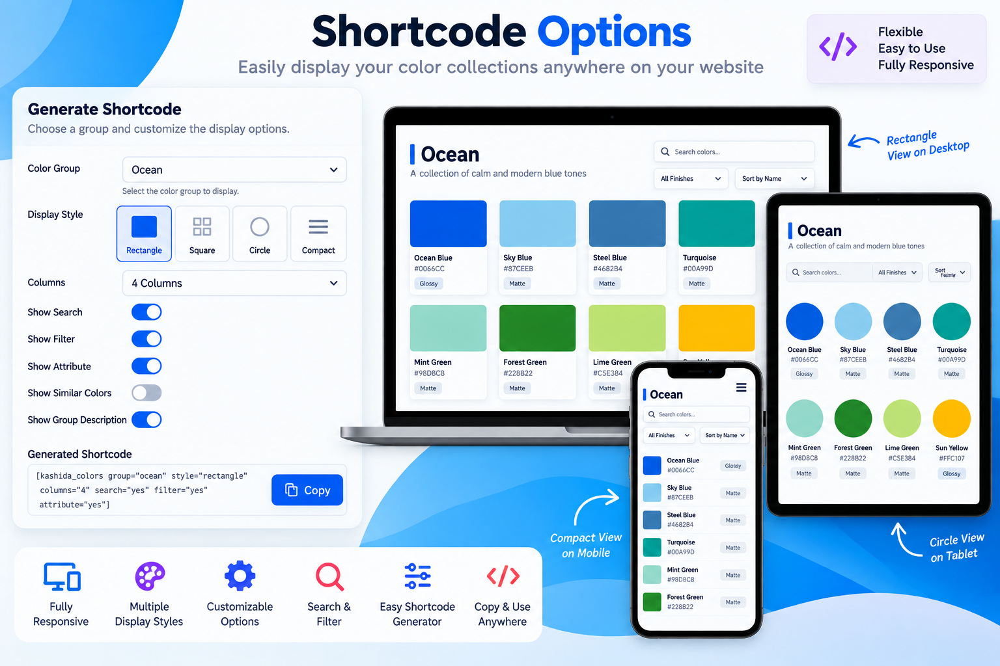
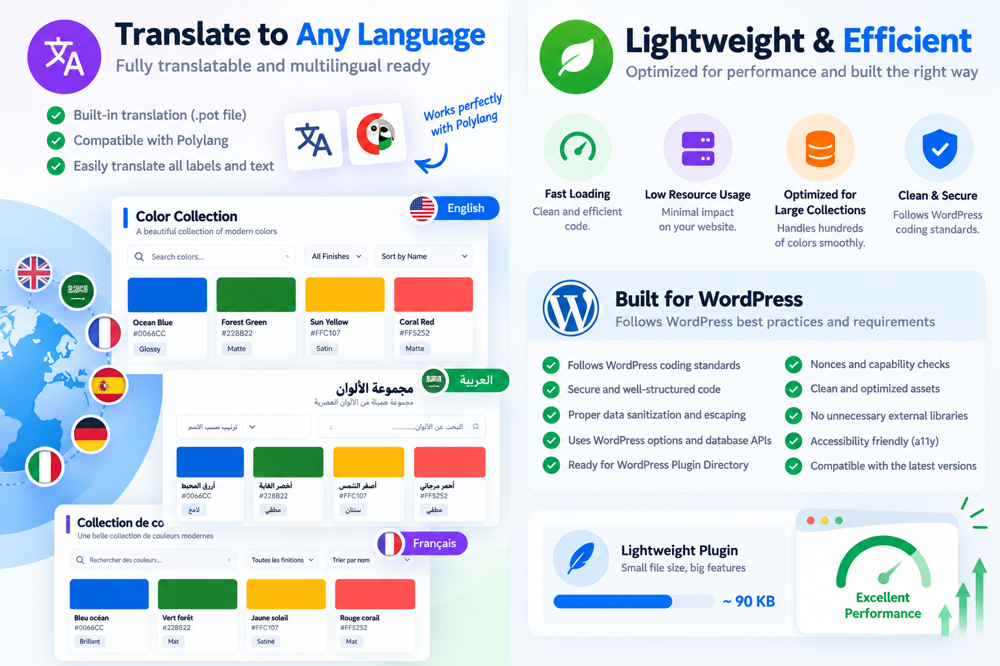
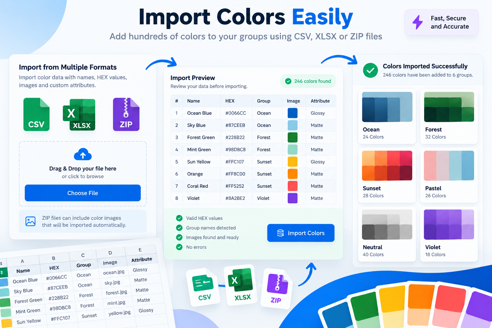
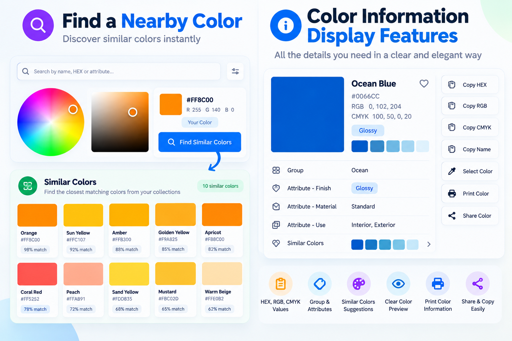
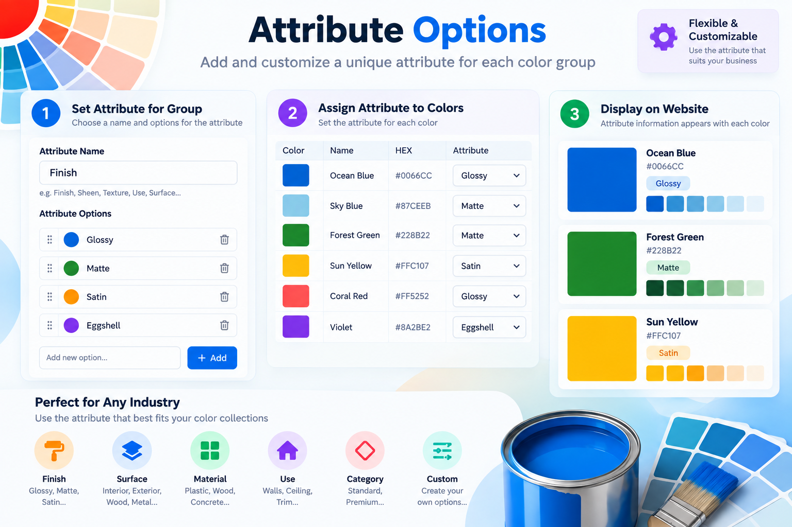

  
   
  

# Kashida Color Library

**Create, manage, import, and display professional color collections with custom attributes, responsive layouts, advanced search and filters, color tools, and an optional read-only REST API for paint visualizer integrations.**

Kashida Color Library is a lightweight, standalone WordPress plugin for building reusable color catalogs. Organize colors into groups, add commercial codes and color values, define industry-specific attributes, import or export catalog data, and publish responsive color collections using shortcodes.

It is suitable for paint brands, fabrics, interior materials, plastics, wood, ceramics, printing, automotive, cosmetics, product catalogs, and any business that needs a dedicated color guide.

 

[Download the latest release](https://github.com/mrwan-bg/kashida-color-library/releases) · [Report a bug](https://github.com/mrwan-bg/kashida-color-library/issues) · [Kashida Media Services](https://kashida.ly/)

> **Version:** 2.7.0 · **License:** GPL-2.0-or-later

## Features

### Color groups and collections
- Create reusable color groups with a stable group code, title, description, featured image, and custom attribute.
- Add color names, commercial codes, HEX values, and optional sample images.
- Define a group-specific attribute label and values, such as Finish, Surface, Material, Texture, or Category.
- Publish individual groups or combine multiple published groups in a collection listing.

### Four responsive display styles
Choose a display style for color cards and collections:
- **Rectangle** — detailed rectangular color cards.
- **Square** — clean square swatches.
- **Circle** — circular color swatches.
- **Compact** — space-efficient color listings.

Configure desktop, tablet, and mobile column counts independently. Display settings can be tailored to the collection and individual groups.

### Color information and discovery tools
- Display color name, commercial code, HEX, RGB, HSL, custom attributes, and sample images.
- Let visitors search by name, code, HEX, RGB, HSL, or configured attribute.
- Filter by group attributes and sort by name, code, attribute, or HEX.
- Use the interactive color wheel to explore nearby colors.
- Discover similar or nearby colors from the available collection.

### Select, copy, print, and share
Visitors can select colors, review selected colors, copy available color information, and print or share color selections.

### CSV, XLSX, and ZIP import
- Import color data from CSV, XLSX, or ZIP files.
- Preview and validate imported data before completing the import.
- Configure duplicate-code handling.
- ZIP imports can include supported sample images matched by color name or code.
- Validate file types, file sizes, data rows, image files, and ZIP paths.

### CSV and XLSX export
Export color group data to CSV or XLSX for external review and catalog workflows.

### Shortcode Generator
Generate display shortcodes without writing code. Select one or more groups, choose the display shape, configure responsive columns, and control which color details, search, filters, sorting, and tools are visible.

### Optional REST API for Paint Visualizer integration
Version 2.7.0 introduces public, read-only REST API endpoints that allow a compatible paint visualizer to read the published color catalog. The Color Library remains a standalone plugin; the API integration is optional and does not make the visualizer a dependency.

**Endpoints**

`GET /wp-json/kashida-colors/v1/groups`

Returns published and enabled color groups, ordered alphabetically by title. Each group includes its ID, stable group code, title, attribute label, and count of valid colors.

`GET /wp-json/kashida-colors/v1/groups/{group_id}/colors`

Returns colors from one published and enabled group. Supports:
- `page` — page number; defaults to 1.
- `per_page` — items per page; defaults to 100 and is limited to 200.
- `search` — searches color name, commercial code, and HEX value.

The response includes group information, color rows, and pagination metadata. Color rows expose only `name`, `code`, `hex`, and `attribute`. Invalid HEX rows are excluded and valid HEX values are normalized. Sample-image URLs, attachment IDs, and administrative metadata are not exposed by these endpoints. Unpublished or disabled groups are not available through the API.

Both endpoints are read-only GET routes. They do not create, edit, or delete catalog data.

### Lightweight, standalone, and privacy-conscious
- Core catalog management and display run within WordPress.
- No external database, third-party API, analytics service, or telemetry is required.
- The optional catalog API only exposes the explicitly documented public group and color fields.
- Imported catalog data and sample images are managed by the WordPress site.

## Main shortcodes

Display one group:

`[kashida_colors_showcase group="KCS-0001"]`

Display published color collections:

`[kashida_collections]`

Customize collection columns and shape:

`[kashida_collections desktop="5" tablet="3" mobile="2" shape="square"]`

Display multiple groups:

`[kashida_colors_showcase groups="KCS-0001,KCS-0002" desktop="6" tablet="4" mobile="2"]`

Hide search, filters, and sorting:

`[kashida_colors_showcase group="KCS-0001" search="false" filter="false" sort="false"]`

Control visible color information:

`[kashida_colors_showcase group="KCS-0001" show_code="false" show_hex="true" show_rgb="true" show_hsl="true"]`

The legacy `[paint_colors]` shortcode may remain available in existing installations, but `[kashida_colors_showcase]` is the recommended namespaced shortcode.

## Screenshots

### 1. Overview

### 2. Color groups

### 3. Color display

### 4. Color tools

### 5. Import and management

### 6. Display configuration

### 7. Additional interface

### 8. Additional interface

## Installation

1. Download the plugin ZIP from the [Releases page](https://github.com/mrwan-bg/kashida-color-library/releases).
2. In WordPress, open **Plugins → Add New Plugin → Upload Plugin**.
3. Upload the ZIP file and select **Install Now**.
4. Activate **Kashida Color Library**.
5. Open **Color Groups** in the WordPress administration menu.
6. Create a group and add colors manually or import CSV, XLSX, or ZIP data.
7. Configure the group attribute and display options.
8. Use the Shortcode Generator and place the generated shortcode in a page or post.

## Requirements

- WordPress 5.8 or later
- PHP 8.0 or later

The core plugin does not require an external API, database, or third-party service. The REST API introduced in 2.7.0 is an optional read-only interface for integrations.

## Plugin information

| Property | Value |
|---|---|
| Current version | 2.7.0 |
| Requires WordPress | 5.8 or later |
| Tested up to | WordPress 7.1 |
| Requires PHP | 8.0 or later |
| License | GPL-2.0-or-later |
| Text domain | `kashida-color-library` |
| Display styles | Rectangle, Square, Circle, Compact |
| Import formats | CSV, XLSX, ZIP |
| Export formats | CSV, XLSX |
| Color data | Name, code, HEX, RGB, HSL, custom attributes, optional images |
| Responsive columns | Desktop, tablet, mobile |
| Optional integration API | Public read-only REST API |
| External services required | None |
| Tracking / telemetry | None |

## Translation and multilingual support

The plugin is prepared for WordPress gettext translations and `.po` / `.mo` files. It supports multilingual workflows with plugins such as Polylang.

## Privacy

Color groups and color information are stored within the WordPress website. The plugin does not send catalog data to Kashida servers and does not require external analytics. The optional REST API makes only the documented public catalog fields available to compatible integrations; it does not expose sample-image attachment data or administrative metadata.

## Latest release: 2.7.0

- Added public, read-only REST API endpoints for listing published, enabled color groups and retrieving their colors.
- Added pagination and search by color name, commercial code, and HEX value to the group-colors endpoint.
- Limited API color output to name, code, HEX, and custom attribute; sample-image URLs, attachment IDs, and administrative metadata are excluded.
- Excluded unpublished groups, disabled groups, and rows with invalid HEX values from the integration API.
- Normalized valid HEX values and preserved the stored color order.
- Kept the API optional so the Color Library continues to work independently.

## Contributing

Bug reports and feature requests are welcome. Please use the repository's [Issues](https://github.com/mrwan-bg/kashida-color-library/issues) page and read [CONTRIBUTING.md](CONTRIBUTING.md) before submitting changes.

## Developer

**Kashida Media Services** — [https://kashida.ly/](https://kashida.ly/)  
**Developer:** Mrwan elGobee — [Behance](https://www.behance.net/Mrwan_elgobee)

## License

This project is distributed under the **GNU General Public License v2.0 or later**. See [LICENSE](LICENSE).
